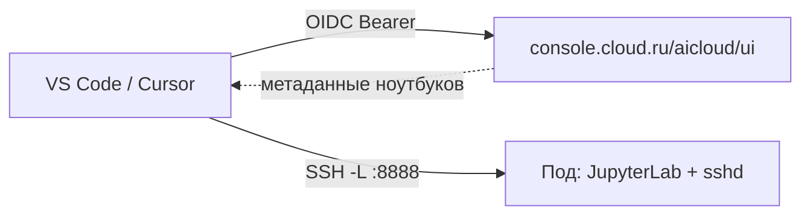

<div align="center">

# Cloud.ru ML Space Notebooks

**Работайте с ноутбуками Cloud.ru ML Space прямо в VS Code — без вкладки браузера.**

Войдите в Cloud.ru, выберите воркспейс, просматривайте свои ноутбуки и открывайте их веб-интерфейс,
запускайте ячейки на облачном ядре, ходите по файлам пода и открывайте полноценный Remote-SSH IDE —
всё из редактора.

[](#лицензия)
[](https://code.visualstudio.com/)
[](https://nodejs.org/)
[](https://pnpm.io/)

</div>

---

## Возможности

- **Вход через Cloud.ru** — по SSO в браузере, без ключей и без регистрации OAuth-клиента.
- **Список ноутбуков** воркспейса с живым статусом; поиск по имени, фильтр по автору и статусу, избранное.
- **Открытие веб-UI ноутбука внутри VS Code** — JupyterLab, marimo, VS Code-образ и другие.
- **Удалённое ядро (как в Colab)** — ячейки исполняются на облачном ядре через стандартное
  Jupyter-расширение.
- **Файлы пода по SSH/SFTP** — браузер файлов прямо в проводнике VS Code.
- **Полный IDE-режим** — открыть под как окно **Remote-SSH** (терминал, IntelliSense на удалёнке).
- **Пауза и запуск** ноутбука одной кнопкой.

---

## Как это работает

Данные (список воркспейсов и ноутбуков, пауза/запуск) идут через **web-API консоли**
(`console.cloud.ru/aicloud/ui`) с OIDC-токеном, который расширение получает так же, как веб-консоль —
захватывает из браузера после SSO. Работа с самим подом (веб-UI, ядро, файлы) идёт через **SSH-туннель**
к поду, минуя OIDC-прокси перед ноутбуком.



Подробности, схемы потоков и карта модулей — в [docs/architecture.md](docs/architecture.md).

---

## Быстрый старт (разработка)

```bash
pnpm install
pnpm bundle:watch     # esbuild watch → dist/extension.js
# нажмите F5 → «Run Extension» (см. .vscode/launch.json)
```

Во втором окне (Extension Development Host): откройте вью **Cloud.ru ML Space** → **Sign in** →
**Select Workspace** → работайте со списком ноутбуков.

Полный гайд (требования, тесты, сборка `.vsix`, публикация, диагностика) —
в [docs/development.md](docs/development.md).

```bash
pnpm test         # юнит-тесты (vitest)
pnpm typecheck    # проверка типов (tsc --noEmit)
pnpm bundle       # разовая сборка
```

---

## Команды

Все доступны через палитру (`Cmd/Ctrl+Shift+P`, префикс «Cloud.ru:») и меню **«…»** на строке ноутбука
(действия описаны словами). Фильтры собраны в меню-воронку в шапке вью.

| Команда | Действие |
|---------|----------|
| Sign In / Sign Out | Вход/выход в Cloud.ru |
| Select Workspace | Выбрать воркспейс |
| Refresh Notebooks | Обновить список |
| Open Notebook in VS Code | Открыть веб-UI ноутбука в редакторе |
| Open Notebook in Browser | Открыть ноутбук во внешнем браузере |
| Start / Pause Notebook | Запустить / поставить на паузу |
| Browse Notebook Files (SSH) | Открыть файлы пода по SFTP |
| Open Full IDE (Remote-SSH) | Открыть под как Remote-SSH окно |
| Configure SSH | Настроить ключ и account-id |
| Search / Filter by Author / Filter by Status / Favorites | Поиск, фильтр по автору и статусу, избранное |

---

## Настройки

| Ключ | По умолчанию | Назначение |
|------|--------------|------------|
| `cloudru.console.apiBaseUrl` | `https://console.cloud.ru/aicloud/ui` | База web-API консоли |
| `cloudru.console.url` | `https://console.cloud.ru/` | URL, открываемый для входа и захвата токена |
| `cloudru.notebook.chromePath` | `` (автоопределение) | Путь к Chrome/Chromium/Edge для входа |
| `cloudru.ssh.privateKeyPath` | `` | SSH-ключ ML Space (для файлов, ядра, IDE) |
| `cloudru.ssh.host` | `ssh-jupyter.ai.cloud.ru` | Дефолтный хост SSH-шлюза (обычно берётся из вставленной SSH-команды) |
| `cloudru.ssh.port` | `2222` | Порт SSH-шлюза |

---

## Документация

| Документ | О чём |
|----------|-------|
| [docs/architecture.md](docs/architecture.md) | Обзор системы, схемы потоков, карта модулей |
| [docs/development.md](docs/development.md) | Запуск в дев-режиме, тесты, сборка, публикация |
| [docs/decisions.md](docs/decisions.md) | Архитектурные решения и их обоснование (ADR) |

Справочник: [`docs/reference/vscode-jupyter-api.d.ts`](docs/reference/vscode-jupyter-api.d.ts) — типы
API Jupyter-расширения, используемого для удалённого ядра.

---

## Структура проекта

```
src/            исходники расширения (console, jupyter, ssh, views, commands, …)
test/unit/      юнит-тесты (vitest)
docs/           документация (архитектура, дев-гайд, решения, справочники)
esbuild.js      бандлер
package.json    манифест расширения (команды, вью, настройки)
```

Карта всех модулей — в [docs/architecture.md](docs/architecture.md#карта-модулей).

---

## Лицензия

Проект распространяется под лицензией **Apache-2.0** (поле `license` в `package.json`).
