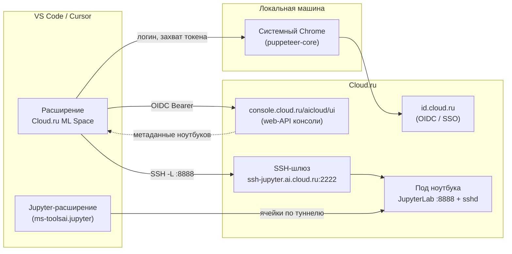
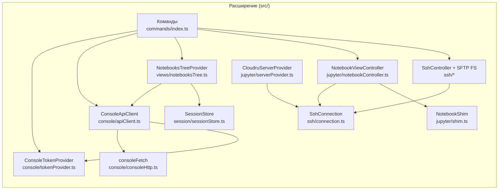
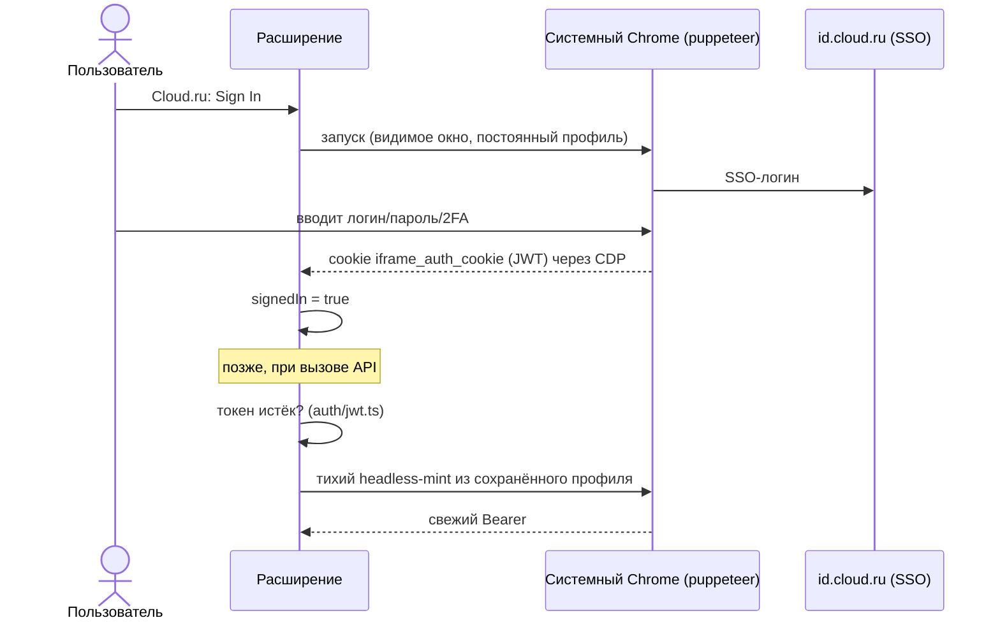
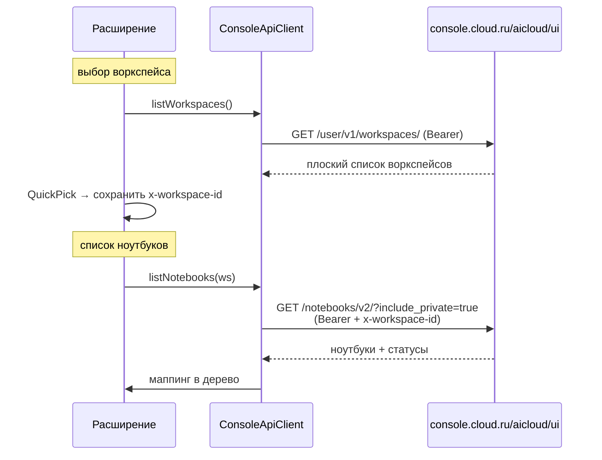
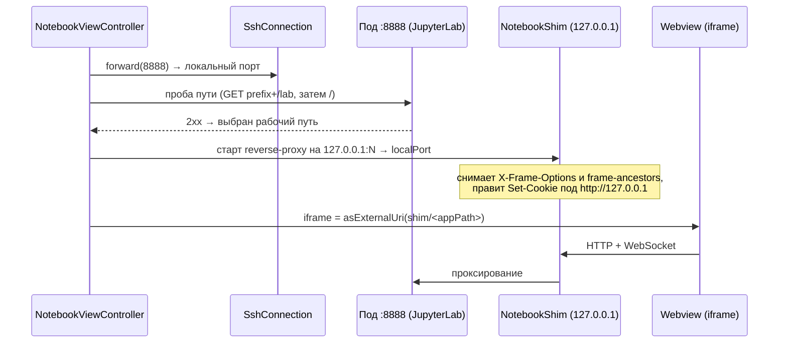
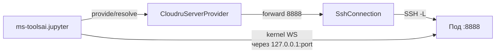
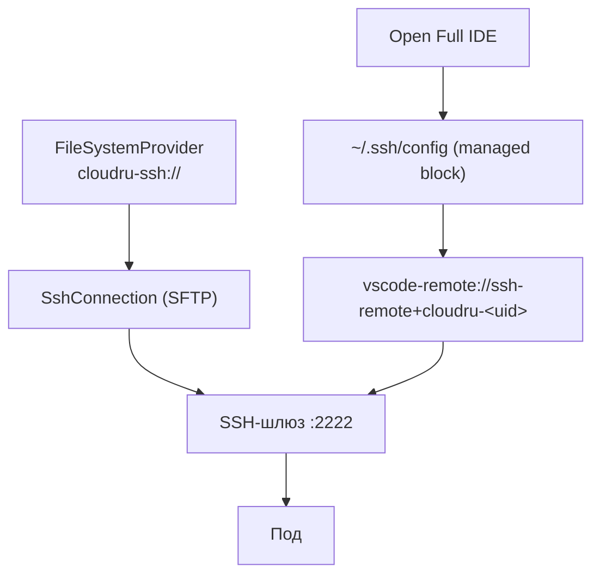
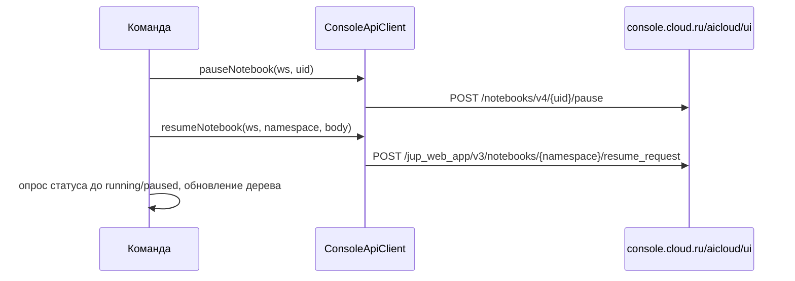

# Архитектура

Документ описывает, как устроено расширение **Cloud.ru ML Space Notebooks** для VS Code: из чего
состоит, как авторизуется, как открывает ноутбуки внутри редактора и как ходит в инфраструктуру
Cloud.ru.

- [Обзор системы](#обзор-системы)
- [Контекст: где живёт расширение](#контекст-где-живёт-расширение)
- [Компоненты](#компоненты)
- [Поток 1. Авторизация](#поток-1-авторизация)
- [Поток 2. Список воркспейсов и ноутбуков](#поток-2-список-воркспейсов-и-ноутбуков)
- [Поток 3. Открытие ноутбука внутри VS Code](#поток-3-открытие-ноутбука-внутри-vs-code)
- [Поток 4. Удалённое ядро (запуск ячеек в облаке)](#поток-4-удалённое-ядро-запуск-ячеек-в-облаке)
- [Поток 5. Файлы по SSH и полный IDE-режим](#поток-5-файлы-по-ssh-и-полный-ide-режим)
- [Поток 6. Пауза и запуск ноутбука](#поток-6-пауза-и-запуск-ноутбука)
- [Сквозные решения](#сквозные-решения)
- [Карта модулей](#карта-модулей)

---

## Обзор системы

Расширение позволяет работать с ноутбуками ML Space прямо из VS Code, не открывая консоль в браузере:

- войти в Cloud.ru (SSO в браузере, без регистрации OAuth-клиента и без ключей);
- выбрать воркспейс и увидеть список своих ноутбуков с актуальным статусом;
- **открыть веб-интерфейс ноутбука прямо в VS Code** (JupyterLab / marimo / VS Code-образ и др.);
- запускать ячейки на **облачном ядре** (как в Google Colab);
- ходить по файлам пода по **SSH/SFTP** или открыть полноценный **Remote-SSH** IDE;
- ставить ноутбук на **паузу** и **запускать** снова.

Ключевая идея: всё, что касается данных (список, пауза/запуск), идёт через **web-API консоли**
(`console.cloud.ru/aicloud/ui`) с OIDC-токеном; а всё, что касается работы с самим подом (web-UI,
ядро, файлы), идёт через **SSH-туннель** к поду, минуя OIDC-прокси перед ноутбуком.

---

## Контекст: где живёт расширение



---

## Компоненты



| Слой | Модули | Ответственность |
|------|--------|-----------------|
| Авторизация | `console/tokenProvider.ts`, `auth/jwt.ts`, `jupyter/chrome.ts` | Захват и тихое обновление OIDC-токена через браузер |
| Данные | `console/apiClient.ts`, `console/consoleHttp.ts`, `console/notebookMapping.ts`, `console/resumeBody.ts`, `api/*` | Вызовы web-API консоли, маппинг DTO, типизованные ошибки |
| Состояние | `session/sessionStore.ts`, `views/favoritesStore.ts`, `views/notebookFilter.ts` | Выбранный воркспейс, избранное, фильтры |
| UI | `views/notebooksTree.ts`, `commands/index.ts`, `util/notebookStatus.ts` | Дерево ноутбуков, команды, иконки статусов |
| Встраивание UI | `jupyter/notebookController.ts`, `jupyter/shim.ts`, `jupyter/headerRewrite.ts`, `jupyter/notebookPanel.ts`, `jupyter/notebookUrl.ts` | Туннель к поду + локальный прокси + webview-iframe |
| Удалённое ядро | `jupyter/serverProvider.ts`, `jupyter/kernelUrl.ts` | Контрибьют ноутбуков как Jupyter-серверов |
| SSH | `ssh/connection.ts`, `ssh/sftpFs.ts`, `ssh/sshController.ts`, `ssh/sshConfig.ts`, `ssh/remoteSsh.ts`, `ssh/serverPreseed.ts`, `ssh/sshConfigFile.ts`, `ssh/sshUrl.ts`, `ssh/sftpErrors.ts` | SFTP-файлы, Remote-SSH, pre-seed сервера, конфиг подключения |
| Инфраструктура | `jupyter/upstreamAgent.ts`, `util/logger.ts`, `extension.ts` | Системные CA, логирование, сборка зависимостей |

---

## Поток 1. Авторизация

Расширение не регистрирует OAuth-клиента и не просит ключей. Оно получает OIDC-токен ровно так же,
как это делает web-консоль: открывает браузер на `console.cloud.ru`, пользователь логинится по SSO, а
расширение читает cookie `iframe_auth_cookie` (это и есть access-token, JWT) через CDP. Профиль
браузера сохраняется, поэтому последующие обновления токена проходят тихо и без окна.



Детали: `ConsoleTokenProvider` сериализует запуски браузера (общий профиль не терпит параллельного
доступа — чистится `SingletonLock`). Токен живёт ~5 минут. Обновление автоматическое: `ConsoleApiClient`
на ответ `401` принудительно сминчивает свежий токен (`getAccessToken(forceRefresh)`) и повторяет
запрос один раз — протухший токен восстанавливается прозрачно, а не роняет сессию.

Когда тихий mint не может выдать валидный токен (SSO-сессия истекла или отозвана), восстановить
нечего: `getAccessToken` помечает сессию выходом (`signedIn = false`), шлёт `onDidChangeAuth(false)`
— дерево возвращается к welcome-экрану «Sign in to Cloud.ru», а последующие вызовы API
коротко замыкаются — и один раз показывает уведомление «Cloud.ru session expired» с кнопкой
**Sign In**, после чего бросает типизированную `NotSignedInError`. Вызывающие
(`NotebooksTreeProvider`, `CloudruServerProvider`) распознают её и не сыплют поверх общим
тостом-ошибкой. Так пользователь видит явный призыв перелогиниться вместо бесконечной загрузки.

---

## Поток 2. Список воркспейсов и ноутбуков



Все запросы несут заголовки `Authorization: Bearer …`, `front-initiator-namespace:
cp-front-mlspace-env-jupyter-server`, а воркспейс-зависимые — ещё и `x-workspace-id`.

---

## Поток 3. Открытие ноутбука внутри VS Code

Веб-UI ноутбука закрыт OIDC-прокси, который (а) не принимает токены, которые мы можем сминтить, и
(б) ставит `X-Frame-Options: DENY` / CSP `frame-ancestors`, запрещая встраивание в iframe. Поэтому
расширение **обходит прокси через SSH-туннель** прямо к JupyterLab внутри пода (он поднят без токена) и
ставит перед ним тонкий локальный прокси (shim), который снимает только запреты на фрейминг.



Почему проба пути: разные образы отдают UI по разным адресам — JupyterLab под `base_url=<prefix>` (то
есть `…/lab`), а marimo/VS Code-образы — с корня `/`. Вместо угадывания по типу образа расширение
делает лёгкий GET и берёт тот путь, что вернул валидный HTTP-ответ.

Детерминированные преобразования заголовков (`headerRewrite.ts`) покрыты юнит-тестами; живой путь
(туннель + webview) проверяется в Extension Development Host.

---

## Поток 4. Удалённое ядро (запуск ячеек в облаке)

Расширение объявляет запущенные ноутбуки как **Jupyter-серверы** для стандартного Jupyter-расширения
(`ms-toolsai.jupyter`). Соединение указывает на локальный конец SSH-туннеля к поду `:8888` (токен
пустой — JupyterLab в поде поднят без токена), поэтому ячейки исполняются на облачном ядре.



`resolveJupyterServer` возвращает `{ baseUrl: http://127.0.0.1:<port>/<prefix>, token: "" }`.

---

## Поток 5. Файлы по SSH и полный IDE-режим

Подключение к поду: `ssh <server-name>.<account-id>@<gateway-host> -p 2222 -i <key>`
(для старых ключей предлагается `ssh-rsa`). Корень — `/home/jovyan`. Эндпоинт шлюза собирается из
данных консоли без копирования команды (`SshConfig.deriveEndpoint`): account-id = namespace активного
воркспейса (`/user/v1/workspaces/`); host/port — из `GET /jup_web_app/v3/notebooks/config?region_type=<RT>`,
где в ответе ищется регион с `key === notebook.region` (напр. `SR008`) и берётся его `ssh.url` / `ssh.port`;
server-name = имя ноутбука. Если данных нет или подключение не удалось — пользователь вставляет команду
из консоли, и она кешируется в `globalState` по региону как ручной override (имеет приоритет).

- **Браузер файлов** — `CloudruSshFsProvider` реализует `FileSystemProvider` для схемы
  `cloudru-ssh://`, поверх SFTP-канала `SshConnection`. Цели подключения сохраняются в `globalState`,
  тихий реконнект переживает перезагрузку окна.
- **Полный IDE** — `remoteSsh.ts` дописывает управляемый блок в `~/.ssh/config`, при необходимости
  предзаливает VS Code Server на под (`serverPreseed.ts`: egress пода к CDN Microsoft затроттлен,
  поэтому тарбол качается локально с кэшем per-commit и заливается по SFTP через быстрый шлюз;
  любая ошибка — не блокер, Remote-SSH доставит сервер сам) и открывает
  `vscode-remote://ssh-remote+cloudru-<uid>/home/jovyan`. Поддерживается любой форк Remote-SSH
  (детектится по `/remote-ssh/i`).



---

## Поток 6. Пауза и запуск ноутбука



Тело запроса для запуска строит `resumeBody.ts` (чистый, тестируемый модуль) из метаданных ноутбука.
`namespace` для эндпоинта берётся из выбранного воркспейса (поле `namespace` из
`/user/v1/workspaces/`, сохраняется в `WorkspaceContext`) — это авторитетный k8s-namespace, в котором
живёт под; namespace самого ноутбука используется как fallback (например, на ручном вводе id
воркспейса). Список `/notebooks/v2/` namespace не всегда отдаёт, поэтому опора на воркспейс надёжнее.

---

## Сквозные решения

- **Корпоративный TLS-перехват.** Node-`fetch` доверяет только встроенному списку CA и падает
  (`fetch failed`) за прокси, который пересоздаёт сертификаты. Поэтому запросы к API идут через
  `consoleHttp.ts` поверх `https.request` с агентом из `upstreamAgent.ts`, который добавляет
  **системное хранилище CA** (`tls.getCACertificates("system")`). Тот же агент используется и shim'ом
  раньше — теперь shim проксирует только локальный http.
- **Чистые модули.** Логика без зависимости от `vscode` (маппинг DTO, разбор URL, заголовки, ошибки,
  resume-body, SSH-config) вынесена в отдельные модули и покрыта юнит-тестами (vitest). Сетевые
  клиенты принимают инъектируемый `fetchImpl`.
- **Секреты.** Выбранный воркспейс хранится в `SecretStorage`; логгер вырезает Bearer-токены и
  чувствительные заголовки из вывода.

---

## Карта модулей

```
src/
  extension.ts              точка входа: сборка зависимостей, регистрация команд/вью/провайдеров
  console/
    tokenProvider.ts        захват/тихое обновление OIDC-токена через браузер
    apiClient.ts            клиент web-API консоли (воркспейсы, ноутбуки, пауза/запуск)
    consoleHttp.ts          https-клиент с доверием системным CA (обход TLS-перехвата)
    notebookMapping.ts      маппинг DTO консоли → модель представления
    resumeBody.ts           сборка тела запроса на запуск ноутбука
  auth/jwt.ts               разбор срока жизни JWT
  api/
    types.ts                модели представления (NotebookHandlerResponse, WorkspaceContext)
    errors.ts               типизованные ошибки API + маппинг HTTP-статусов
  session/sessionStore.ts   активный воркспейс (x-workspace-id), в SecretStorage
  views/
    notebooksTree.ts        дерево ноутбуков
    notebookFilter.ts       поиск по имени, фильтр по автору, «только избранное»
    favoritesStore.ts       избранные ноутбуки (globalState)
  commands/index.ts         все команды расширения
  jupyter/
    notebookController.ts   открытие веб-UI: туннель → проба пути → shim → webview
    shim.ts                 локальный reverse-proxy для встраивания в iframe
    headerRewrite.ts        снятие X-Frame-Options/CSP, правка Set-Cookie (чистый модуль)
    notebookPanel.ts        webview-панель с iframe
    notebookUrl.ts          разбор URL ноутбука → префикс
    serverProvider.ts       контрибьют ноутбуков как Jupyter-серверов (удалённое ядро)
    kernelUrl.ts            построение baseUrl ядра по префиксу
    upstreamAgent.ts        https-агент с системными CA
    chrome.ts               поиск исполняемого Chrome/Chromium/Edge
  ssh/
    connection.ts           один SSH-клиент: SFTP + локальный forward (ssh -L) + exec
    sftpFs.ts               FileSystemProvider для cloudru-ssh://
    sshController.ts        команды браузера файлов по SSH
    sshConfig.ts            разрешение цели подключения (ключ, account-id, host)
    remoteSsh.ts            запуск полного Remote-SSH окна
    serverPreseed.ts        предзаливка VS Code Server на под перед Remote-SSH (чистый модуль)
    sshConfigFile.ts        управляемый блок в ~/.ssh/config (чистый модуль)
    sshUrl.ts               разбор/сборка cloudru-ssh:// URI
    sftpErrors.ts           маппинг ошибок SFTP
  util/
    notebookStatus.ts       иконки/подписи статусов
    logger.ts               канал вывода с вырезанием секретов
```

Подробности по запуску в дев-режиме — в [development.md](./development.md); зафиксированные
архитектурные решения и их обоснование — в [decisions.md](./decisions.md).
